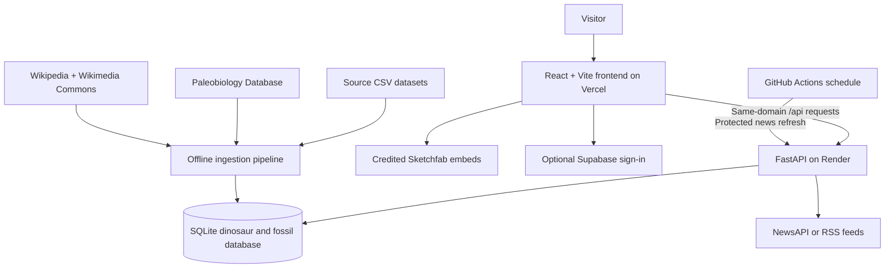

<div align="center">

# 🦖 Facts Dinosaurs

### *A window into the Mesozoic world.*

**Explore dinosaurs through an illustrated encyclopedia, interactive 3D models, fossil locations, and size comparisons** — connecting prehistoric animals to the evidence they left behind.


**[🌐 Explore the website](https://dino-olive-kappa.vercel.app)** · **[Encyclopedia](https://dino-olive-kappa.vercel.app/encyclopedia)** · **[Compare dinosaurs](https://dino-olive-kappa.vercel.app/compare)** · **[Latest discoveries](https://dino-olive-kappa.vercel.app/news)**

</div>

---

> *How big was it? Where did it live? What did we find?*
>
> Search a dinosaur, inspect a specimen in three dimensions, locate fossil discoveries, and compare its size with other prehistoric animals. Facts Dinosaurs brings these perspectives together in one place.

The live site uses **one public link**. Its free backend wakes on incoming requests after inactivity, so the first data load may take about a minute.

## ✨ Highlights

| | Feature | What you can do |
| --- | --- | --- |
| 📚 | **Dinosaur encyclopedia** | Browse 1,056 entries verified in the deployed catalogue, search by name, and switch between grid and list views grouped by geologic period. |
| 🦴 | **Detailed profiles** | Explore diet, taxonomy, dimensions, species, naming credits, and Wikipedia links where records are available. |
| 🌀 | **Interactive 3D specimens** | Rotate and zoom credited Sketchfab models for supported dinosaurs. Availability varies by genus and device. |
| 🗺️ | **Fossil locations** | Explore occurrence locations and accompanying formation, region, and geological age data from the Paleobiology Database. |
| 📏 | **Size comparisons** | Add dinosaurs to a shared comparison view with a human reference. The visualization uses recorded length as a rough size proxy. |
| 📰 | **Palaeontology news** | Browse discovery stories with publisher credits, links, and available thumbnails. Collection supports NewsAPI with an RSS fallback. |
| 🌗 | **Light and dark themes** | Switch the interface theme while exploring the responsive site. |

## 🧠 How it works



1. The frontend requests dinosaur records, fossil occurrences, and news through `/api`.
2. Vercel forwards those requests to Render while keeping the website URL unchanged.
3. FastAPI reads the populated SQLite database included in the repository.
4. Offline ingestion combines source datasets with fossil records and image links; ordinary browsing does not rerun ingestion. Separate backfills add or update media.
5. A scheduled GitHub Actions workflow can refresh news through a token-protected endpoint.

## 📁 Project structure

```text
Dino/
├── frountend/                  # React + TypeScript app (folder spelling preserved)
│   ├── src/
│   │   ├── components/         # Shared layout, navigation, and controls
│   │   ├── pages/              # Landing, encyclopedia, details, compare, and news
│   │   └── lib/                # Typed API client, authentication, and theme
│   ├── public/assets/          # Landing video, illustrations, and map geometry
│   ├── vite.config.ts          # Local /api proxy
│   └── vercel.json             # Hosted /api forwarding and SPA fallback
├── backend/
│   ├── app/
│   │   ├── routers/            # Dinosaur, fossil, and news endpoints
│   │   └── ingest/             # Dataset loading and media/news backfills
│   ├── dinosaurs.db            # Populated SQLite database included in Git
│   └── requirements.txt        # Python dependencies
├── .github/workflows/          # Scheduled news refresh
├── .vercelignore               # Excludes credentials and backend data from uploads
└── render.yaml                 # Existing Render API and static frontend configuration
```

## 🚀 Quick start

### Prerequisites

- Python with support for the pinned packages in `backend/requirements.txt`.
- Node.js **22.12+** or **24**, with npm. The hosted frontend uses Node 24.
- The populated **`backend/dinosaurs.db`**, included in this repository. Initial browsing does not require rebuilding the database or downloading source CSVs.

### 1 · Clone and start the API

```powershell
git clone https://github.com/lukan-lawslaf/Dino.git
cd Dino/backend

python -m venv .venv
.\.venv\Scripts\Activate.ps1
pip install -r requirements.txt

python -m uvicorn app.main:app --reload --port 8000
```

On macOS/Linux, activate the environment with `source .venv/bin/activate`.

API documentation is available at **http://localhost:8000/docs**.

### 2 · Start the frontend

In another terminal, from the cloned repository:

```powershell
cd frountend
npm ci
npm run dev
```

Open **http://localhost:5173**. Vite forwards `/api` requests to `http://localhost:8000`.

### 3 · Optional configuration

Backend settings are read from a `.env` file in the repository root. The frontend reads `frountend/.env`. Both files are excluded from Git.

| Setting | Location | Purpose |
| --- | --- | --- |
| `DATABASE_URL` | Root `.env` | Defaults to `sqlite:///./dinosaurs.db`; start the API from `backend/`. |
| `CORS_ORIGINS` | Root `.env` | Comma-separated origins for clients calling the backend directly. Local frontend origins are configured by default. |
| `DINO_FACTS_CSV`, `DINO_STATS_CSV` | Root `.env` | Source CSV paths for rebuilding the database. |
| `PBDB_BASE_URL`, `PBDB_REQUEST_DELAY_SECONDS` | Root `.env` | Fossil data source and ingestion request delay. |
| `NEWSAPI_KEY` | Root `.env` | Optional NewsAPI integration; without a key, collection uses RSS feeds. |
| `NEWS_FEEDS` | Root `.env` | RSS sources in `Name\|url,Name\|url,...` format. |
| `NEWS_REFRESH_TOKEN` | Root `.env` / backend hosting settings | Shared secret protecting `POST /news/refresh`. |
| `VITE_API_BASE` | `frountend/.env` | Defaults to `/api`; accepts a relative prefix or an explicit backend origin. Production uses `/api`. |
| `VITE_SUPABASE_URL`, `VITE_SUPABASE_ANON_KEY` | `frountend/.env` | Optional existing Supabase sign-in settings. Use only a public browser key. |

Keep backend provider keys, refresh tokens, and Supabase service-role keys out of `VITE_` variables: those values are included in browser code.

## 🔌 Useful endpoints

Hosted routes use **`https://dino-olive-kappa.vercel.app/api`** as their base. Local FastAPI routes do not include the `/api` prefix.

| Endpoint | Purpose |
| --- | --- |
| `GET /` | Basic service status; does not check database readiness |
| `GET /dinosaurs?page=1&page_size=20` | Paginated dinosaur catalogue |
| `GET /dinosaurs/search?q=tyrannosaurus` | Search by name |
| `GET /dinosaurs/filter?diet=&period=&region=` | Filter catalogue records |
| `GET /dinosaurs/{name}` | Full profile with fossil occurrences and media links |
| `GET /dinosaurs/{name}/model` | 3D embed URL, source, and attribution |
| `GET /fossils/{name}` | Fossil occurrence records for a dinosaur |
| `GET /news?page=1&page_size=20&source=` | Paginated news feed with an optional publisher filter |
| `POST /news/refresh` | Refresh news; requires the `X-Refresh-Token` header |

## 🛠️ Data and news maintenance

Run these commands from `backend/`, with its Python environment activated:

```powershell
# Rebuild from the source CSVs and fetch fossil/image records.
python -m app.ingest.run

# Fill missing images and curated 3D model links independently.
python -m app.ingest.backfill_images
python -m app.ingest.backfill_models

# Refresh news without rebuilding dinosaur records.
python -m app.ingest.refresh_news
```

The source CSVs, `dino_facts.csv` and `dino_stats.csv`, are excluded from Git. Supply them and configure their paths before rebuilding. Ingestion upserts dinosaur records and replaces their fossil occurrences; back up your database before a rebuild. Fossil requests are rate-limited, so a full run can take several minutes or longer.

Image backfills support `--force`. Model backfills support `--all` and `--force`; availability depends on the upstream catalogue. Preserve creator attribution and source links when displaying or reusing media.

The news workflow in [`.github/workflows/refresh-news.yml`](.github/workflows/refresh-news.yml) is configured for **06:17 UTC daily**, with a manual run option. It requires repository secrets `API_URL` and `NEWS_REFRESH_TOKEN`; the token must match the backend's value. Collection deduplicates articles by link. Use a NewsAPI plan appropriate to your deployment and its terms.

## ☁️ Deployment

| Component | Host | Plan |
| --- | --- | --- |
| React frontend and same-domain `/api` routing | Vercel | Hobby |
| FastAPI and SQLite database | Render | Free |
| Scheduled news refresh | GitHub Actions | Subject to account usage limits |

**Visitors only need [the website link](https://dino-olive-kappa.vercel.app).** The frontend allows time for the sleeping backend to wake and retries temporary gateway errors on read requests.

The Vercel project is **`dino`**, with **`frountend`** as its root directory, `npm ci` as its install command, `npm run build` as its build command, and `dist` as its output directory. Its `/api` rewrite points to the existing `rayquaza-api` Render service. The existing Render frontend remains available separately.

The current Vercel release was uploaded through the CLI. **Automatic Vercel deployments from GitHub are not connected yet.** Render remains configured to deploy from `main` automatically. To update Vercel, use the linked project from the repository root:

```powershell
vercel project inspect --non-interactive --scope nakulf2007-2371s-projects
vercel deploy --prod --project dino --scope nakulf2007-2371s-projects --yes
```

The checked-in SQLite database seeds the backend on deployment. Runtime writes on Render's free filesystem can be lost on restart or redeployment, including news added since the last database snapshot.

## 🧪 Validation and current limits

```powershell
# Frontend type checking and production build
cd frountend
npm run build
```

The **25 October 2026** release passed the frontend production build and anonymous checks of the public homepage, direct encyclopedia route, same-domain catalogue API, Tyrannosaurus profile, news feed, landing video, and map geometry. Browser checks also confirmed catalogue search and profile navigation. The API returned **1,056 dinosaurs**, **86 Tyrannosaurus fossil records**, and **156 news articles** at verification time.

- **Sign-in needs attention:** the configured Supabase hostname did not resolve during deployment verification. Public browsing works without sign-in; authentication has not been verified.
- **Data coverage varies:** some entries have missing dimensions, taxonomy, images, or fossil information.
- **3D rendering depends on the device:** an embed can load while the model exceeds a device's rendering capacity.
- **Size comparisons are illustrative:** dinosaur length and human height are different measurements, so the chart is not an anatomical reconstruction.

These are deployment-time checks, not a continuous uptime guarantee.

## 📚 Data and credits

Source data and third-party media retain their own licences and attribution requirements.

- **Paleobiology Database (PBDB)** — fossil occurrences, locations, geological intervals, and formations.
- **Dinosaur facts and statistics CSVs** — source records merged by dinosaur name; retain original dataset provenance when redistributing them.
- **Wikipedia and Wikimedia Commons** — linked reference pages and dinosaur imagery; media licences vary by file.
- **Sketchfab creators** — embedded models selected for CC0 or CC-BY licensing, with source and creator credits in the viewer.
- **News publishers and RSS feeds / NewsAPI** — discovery stories linked back to their original publishers.

Fossil locations describe recorded discoveries, not complete historical ranges. Review original sources before reusing records, images, models, or article content.

---

<div align="center">

**Built with React · Vite · FastAPI · SQLite · Sketchfab** 🦖

*Millions of years. One place to explore.*

</div>
